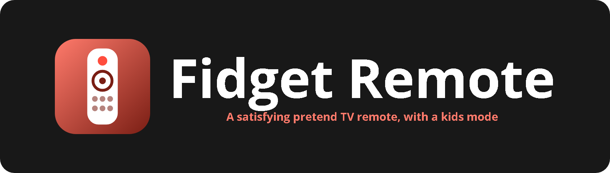
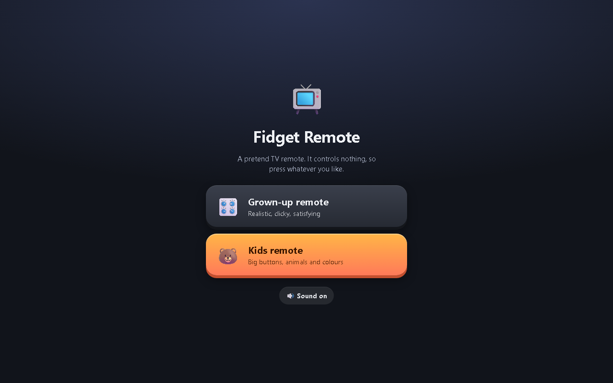

<p align="center"></p>

<p align="center">    </p>

A pretend TV remote that controls nothing, made for fidgeting and play. The grown-up mode is a realistic, clicky remote with a little TV that reacts to every button. The kids mode has big colourful buttons, silly sounds and a cartoon TV, with a parent lock to get out.

<p align="center"></p>

## Features

- Grown-up remote: power, numbers, volume, channels, d-pad, colour buttons and more
- Press animations, haptics (where supported) and synthesised click sounds
- Mini CRT TV with power-on effect, 12 fake channels, static, volume bar and a home menu
- Kids mode: 12 chunky buttons with chimes and animal sounds, a wobbling cartoon TV and confetti
- Parent lock (hold for 3 seconds) and back-button trap in kids mode
- Zoom, text selection and long-press menus blocked for uninterrupted fidgeting

## Getting started

No build step and no dependencies. Clone the repo and open `index.html`, or serve the folder locally:

```bash
git clone https://github.com/Squidly1408/fake-remote.git
cd fake-remote
python -m http.server 8791
```

Then visit http://localhost:8791.

## Project structure

| File | Purpose |
|---|---|
| `index.html` | App shell |
| `app.js` | Remote, TV and kids mode logic |
| `style.css` | Styles |
| `assets/` | Logo and README images |

## Built with

HTML, CSS, JavaScript (Web Audio API, Vibration API)

## Limitations

- Vibration does not work on iPhone (Safari)
- Sound starts after the first tap (browser rule)
- Kids mode cannot block the home gesture; use Guided Access (iPhone) or screen pinning (Android)

## License

Released under the [MIT License](LICENSE).
